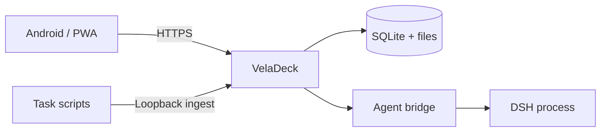

<p align="center">
  <picture>
    <source media="(prefers-color-scheme: dark)" srcset="docs/brand/hero-dark.png">
    
  </picture>
</p>

<p align="center">
  <strong>A calmer place for your AI agents.</strong><br>
  Review the output. Continue the conversation. Keep the final say.
</p>

<p align="center">
  <a href="https://github.com/zuquanzhi/veladeck/actions/workflows/ci.yml"></a>
  <a href="https://github.com/zuquanzhi/veladeck/releases"></a>
  <a href="LICENSE"></a>
  <a href="package.json"></a>
</p>

<p align="center">
  <a href="#why-veladeck">Why VelaDeck</a> ·
  <a href="#a-closer-look">Screenshots</a> ·
  <a href="#get-started">Get started</a> ·
  <a href="https://github.com/zuquanzhi/veladeck/releases">Download APK</a> ·
  <a href="README.zh-CN.md">简体中文</a>
</p>

---

Your agents can work for hours. Keeping up should take moments.

VelaDeck brings their reports, conversations, approval requests and operational signals into one personal workspace. Open it on your phone, pick up where you left off, and step in when a decision needs you.

**Self-hosted. Mobile first. Open source.** A small service, a SQLite database and a workspace that stays out of your way.

> **Preview software.** Bring your own HTTPS server and configured agent backend. The Android app is a client, not a hosted AI service. See [validation and integration status](docs/VALIDATION.md).

## Why VelaDeck

| Less switching | More control |
| :--- | :--- |
| **A home for the output.** Search reports, preview files, star what matters and compare saved revisions. | **Decisions stay yours.** Review requests with context; dangerous approvals require a scoped passkey assertion. |
| **Conversations that continue.** Stream agent events, stop a task and replay persisted events after reconnecting. | **Your own infrastructure.** Loopback service, device pairing, SQLite and files. No hosted account required. |
| **An Inbox for loose ends.** Save a link or thought, then turn it into an agent task when ready. | **A clearer operational picture.** Host telemetry, reported usage and budget signals, with unavailable sources shown honestly. |

## A closer look

Light when you want clarity. Dark when you want focus.

<picture>
  <source media="(prefers-color-scheme: dark)" srcset="docs/screenshots/workspace-desktop-dark.png">
  
</picture>

<p align="center">
  
  &nbsp;&nbsp;
  
  &nbsp;&nbsp;
  
</p>

<sub>Screenshots show the real application with clearly seeded demonstration content. They contain no personal reports or live account balances.</sub>

## Get started

### On your phone

1. Deploy VelaDeck behind your authenticated HTTPS reverse proxy.
2. [Download the Android preview](https://github.com/zuquanzhi/veladeck/releases), or install the PWA from a compatible browser.
3. Enter your workspace URL and pair your device with a one-time code.

Android **8.0+**. The companion uses browser-backed tabs to retain the browser's TLS, cookies and passkey boundary. For background notifications, install the PWA as well.

<details>
<summary>About preview APK signing</summary>

The APK currently uses a development certificate and a separate `.preview` package ID. Builds from different CI runners can require uninstalling the previous preview. Production signing and app-store distribution are not configured.

</details>

### On your server

Requires **Node.js 22+**. The supported deployment target is Ubuntu with an existing HTTPS reverse proxy.

```sh
git clone https://github.com/zuquanzhi/veladeck.git
cd veladeck
npm ci
cp .env.example .env
```

Set a private, randomly generated `INGEST_TOKEN` in `.env`, then:

```sh
npm run build
npm start
```

In another terminal, run `npm run pair`. For local verification, open [localhost:8090](http://localhost:8090); phone access needs your HTTPS endpoint.

[Installation, environment and deployment guide →](docs/GETTING_STARTED.md)

## How it fits



One Node service. React on the front. SQLite underneath.

The first adapter is a configurable DSH subprocess bridge. Other backends can be added at the adapter boundary; they are not presented as already connected. [Protocol and decisions →](docs/DECISIONS.md)

## Built with a little restraint

- System typography, fine borders, soft depth and a small electric-blue accent.
- One editable vector identity across web, PWA, Android and the repository.
- Light, dark and system themes. Keyboard search with `⌘/Ctrl K`.
- Responsive layouts, visible focus states and reduced-motion support.
- No UI framework, ORM or application state library added for the visual layer.

[Visual identity and assets →](docs/brand/README.md)

## Development

```sh
npm run dev
npm run verify
npm run build
bash scripts/smoke.sh
```

Verification covers strict TypeScript, ESLint, automated security/workflow tests and an HTTP smoke harness. GitHub Actions builds and lints the Android app; version tags produce APK/server assets and SHA-256 checksums.

| Read | Purpose |
| :--- | :--- |
| [Getting started](docs/GETTING_STARTED.md) | Install, configure, pair and self-host |
| [Validation](docs/VALIDATION.md) | What has actually been tested |
| [Design decisions](docs/DECISIONS.md) | Scope, security choices and remaining work |
| [Changelog](CHANGELOG.md) | Changes by milestone and release |
| [Security](SECURITY.md) | Boundaries and private reporting |

## Build with us

Small, thoughtful improvements are welcome. A clear issue, a focused fix, a better empty state, a tested adapter — all count.

Read [CONTRIBUTING.md](CONTRIBUTING.md) before opening a pull request. Please keep credentials and personal artifact content out of public issues.

## License

[MIT](LICENSE). Make it yours.

<p align="center"><sub>VelaDeck · Your agents. Within reach.</sub></p>
