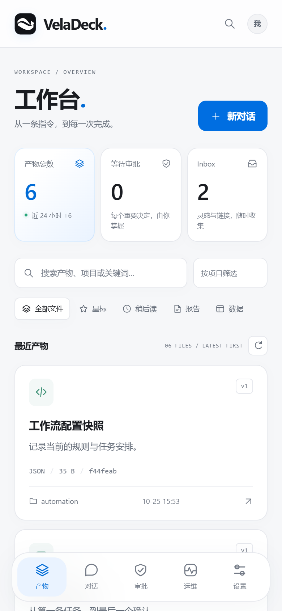
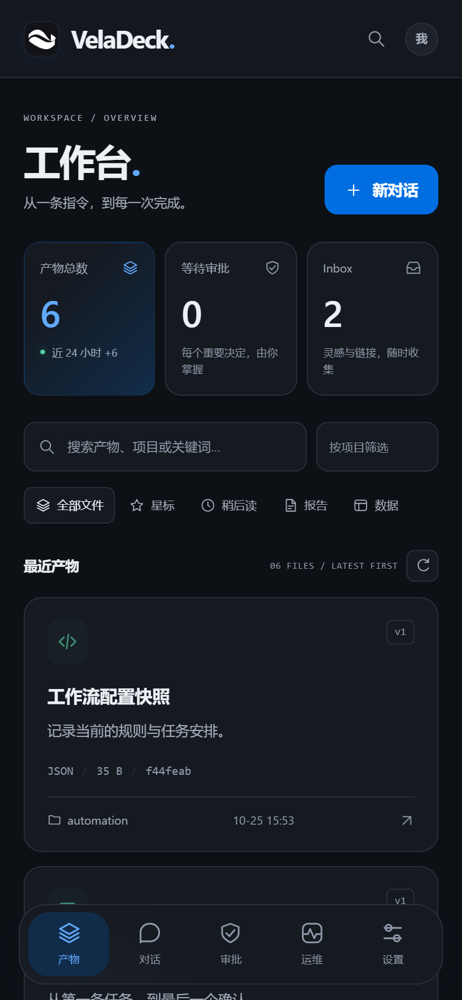
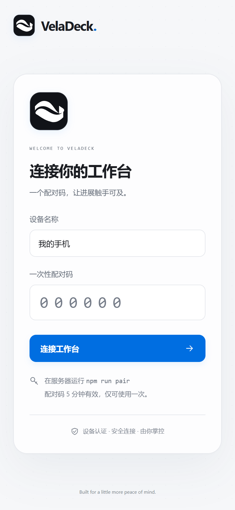
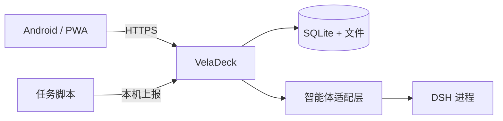

<p align="center">
  <picture>
    <source media="(prefers-color-scheme: dark)" srcset="docs/brand/hero-dark.png">
    
  </picture>
</p>

<p align="center"><strong>让智能体工作，让进展触手可及。</strong><br>查看产出，接续对话，掌握最后的决定。</p>

<p align="center">
  <a href="https://github.com/zuquanzhi/veladeck/actions/workflows/ci.yml"></a>
  <a href="https://github.com/zuquanzhi/veladeck/releases"></a>
  <a href="LICENSE"></a>
</p>

<p align="center">
  <a href="#为什么做-veladeck">为什么做</a> ·
  <a href="#看看界面">界面预览</a> ·
  <a href="#开始使用">开始使用</a> ·
  <a href="https://github.com/zuquanzhi/veladeck/releases">下载 APK</a> ·
  <a href="README.md">English</a>
</p>

---

智能体可以连续工作很久。掌握它们的进展，应该只需要片刻。

VelaDeck 把报告、对话、审批和运行信号放进一个个人工作台。用手机打开，接上上次的任务，在真正需要你决定时出手。

**自己托管，手机优先，开源可控。** 一个服务、一个 SQLite 数据库，以及一个安静、有序的界面。

> **当前为预览版。** 需要你自己的 HTTPS 服务与已配置的智能体后端。APK 是客户端，不提供现成的云端 AI 服务。实际验证范围见 [验证记录](docs/VALIDATION.md)。

## 为什么做 VelaDeck

| 少一点切换 | 多一点掌控 |
| :--- | :--- |
| **让产出有处可寻。** 搜索报告、预览文件、星标收藏，比较同一产物的历史修订。 | **让决定留在手中。** 带着上下文审阅审批，危险操作必须完成通行密钥验证。 |
| **让对话接得上。** 流式查看智能体事件，停止任务，重连后补发已保存的进展。 | **让数据留在自己手里。** 回环服务、设备配对、SQLite 与文件，无需托管账号。 |
| **让灵感先落地。** 把链接与想法放进 Inbox，准备好后再转成任务。 | **让运行状态更清晰。** 主机指标、上报用量与预算信号；未连接的数据源明确标注。 |

## 看看界面

浅色保持清晰，深色留给专注。

<picture>
  <source media="(prefers-color-scheme: dark)" srcset="docs/screenshots/workspace-desktop-dark.png">
  
</picture>

<p align="center">
  
  &nbsp;&nbsp;
  
  &nbsp;&nbsp;
  
</p>

<sub>截图来自实际应用，使用明确标注的演示数据，不包含个人报告或真实账号余额。</sub>

## 开始使用

### 手机端

1. 在已有的认证 HTTPS 反向代理后部署 VelaDeck。
2. [下载 Android 预览版](https://github.com/zuquanzhi/veladeck/releases)，或通过兼容浏览器安装 PWA。
3. 输入工作台地址，用服务器生成的一次性配对码连接设备。

支持 **Android 8.0+**。APK 通过浏览器支持的窗口访问工作台，保留浏览器的 TLS、Cookie 与通行密钥边界。后台通知建议同时安装 PWA。

<details>
<summary>预览版 APK 签名说明</summary>

当前使用开发证书，包名带有独立的 `.preview` 后缀。不同 CI 运行器生成的安装包可能需要先卸载旧预览版。正式签名与应用商店发布尚未配置。

</details>

### 服务端

需要 **Node.js 22+**，目标部署环境为 Ubuntu 和已有的 HTTPS 反向代理。

```sh
git clone https://github.com/zuquanzhi/veladeck.git
cd veladeck
npm ci
cp .env.example .env
```

在私有 `.env` 中配置随机生成的 `INGEST_TOKEN`，然后：

```sh
npm run build
npm start
```

另开终端执行 `npm run pair` 获取配对码。本地验证可访问 [localhost:8090](http://localhost:8090)，手机访问则使用你的 HTTPS 地址。

[完整安装、环境配置与部署指南 →](docs/GETTING_STARTED.md)

## 工作方式



一个 Node 服务，React 前端，SQLite 存储。

当前提供可配置的 DSH 子进程适配层。其他后端可以通过适配边界扩展；不会把尚未接通的后端标成可用。详见 [设计决策与范围](docs/DECISIONS.md)。

## 有一点克制的设计

- 系统字体、细边框、轻层次和少量电蓝强调。
- Web、PWA、Android 与仓库共用的可编辑矢量标记。
- 浅色、深色与跟随系统主题，`⌘/Ctrl K` 快速搜索。
- 适配手机与桌面，保留键盘焦点与减少动态效果支持。
- 视觉层没有引入新的 UI 框架、ORM 或状态库。

[品牌素材与设计约定 →](docs/brand/README.md)

## 参与开发

```sh
npm run dev
npm run verify
npm run build
bash scripts/smoke.sh
```

| 文档 | 内容 |
| :--- | :--- |
| [安装指南](docs/GETTING_STARTED.md) | 安装、环境、配对与自托管 |
| [验证记录](docs/VALIDATION.md) | 已实际检查的内容 |
| [设计决策](docs/DECISIONS.md) | 安全选择、范围与剩余工作 |
| [更新记录](CHANGELOG.md) | 里程碑与版本变化 |
| [安全约定](SECURITY.md) | 安全边界与私密报告 |

欢迎清晰的问题、聚焦的修复、体验改进和经过验证的新适配器。提交前请阅读 [贡献指南](CONTRIBUTING.md)，不要在公开 Issue 中附带凭据或个人产物原文。

## 开源许可

[MIT](LICENSE)。把它变成适合你的工作台。

<p align="center"><sub>VelaDeck · Your agents. Within reach.</sub></p>
